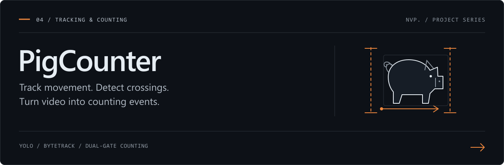
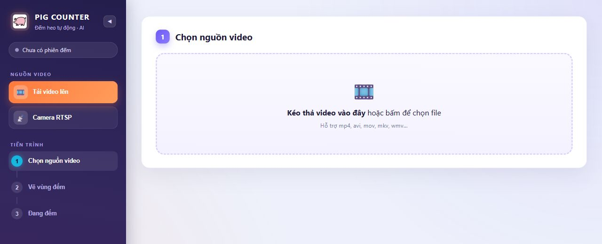
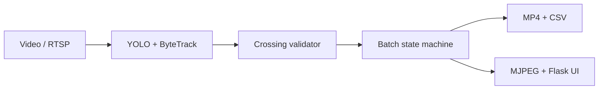
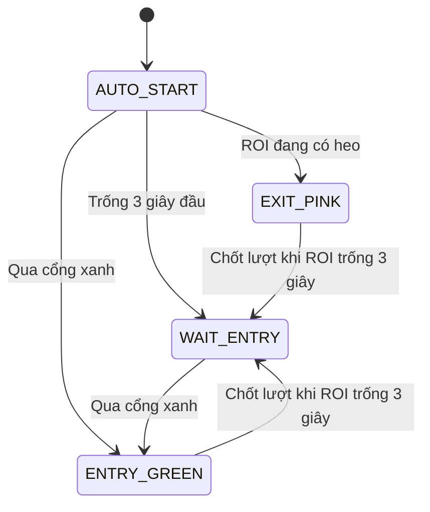

<div align="center">

# PigCounter

### From tracked motion to auditable counting events.

Ứng dụng thị giác máy tính đếm heo theo sự kiện qua cổng, từ video hoặc camera RTSP.

   

[Pipeline](#pipeline) · [Logic đếm](#logic-đếm) · [Khởi chạy](#khởi-chạy) · [Cấu hình](#cấu-hình) · [Dữ liệu đầu ra](#dữ-liệu-đầu-ra)

</div>



<p align="center"><sub>Giao diện khởi tạo phiên đếm thực tế. Ảnh chụp chưa chứa video đầu vào hoặc kết quả suy luận.</sub></p>

## Bài toán

Trong một luồng video, cùng một con heo có thể xuất hiện ở nhiều frame, dừng gần cổng hoặc quay đầu. PigCounter chuyển chuỗi phát hiện thành **sự kiện qua cổng đã được xác nhận**, sau đó tổng hợp theo từng lượt. Người vận hành tự vẽ vùng chuồng và hai cổng ngay trên khung hình nguồn.

| Khả năng | Triển khai |
| --- | --- |
| Nguồn dữ liệu | Upload video hoặc kết nối camera RTSP. |
| Thiết lập hình học | ROI đa giác và hai đoạn thẳng, lưu bằng tọa độ chuẩn hóa. |
| Theo dõi và đếm | YOLO + ByteTrack, xác nhận chiều đi qua cổng và điều chỉnh khi đi ngược. |
| Vận hành | Tạm dừng, tiếp tục, chỉnh lại ROI/cổng và khôi phục nguồn/vùng vẽ gần nhất. |
| Kết quả | Video có chú thích, CSV theo lượt và CSV từng sự kiện. |

## Pipeline



| Quyết định kỹ thuật | Lý do |
| --- | --- |
| Nạp model một lần và dùng khóa suy luận | Tái sử dụng trọng số; tuần tự hóa truy cập trạng thái tracker dùng chung. |
| Tọa độ ROI/cổng chuẩn hóa | Ánh xạ hình học theo kích thước khung hình của nguồn. |
| Máy trạng thái riêng cho mỗi track/cổng | Tích lũy bằng chứng nhiều frame trước khi ghi một sự kiện. |
| CSV ghi nối tiếp | Chỉ ghi các dòng mới phát sinh. |
| UI chỉ nhận 50 lượt gần nhất | Giới hạn kích thước phần lịch sử trong mỗi lần polling; CSV giữ lịch sử đã xuất. |

Lõi đếm kế thừa `pig_counter_dual_gate_v5_1.py`, được tích hợp và tổng quát hóa trong [engine.py](engine.py). [app.py](app.py) quản lý nguồn, phiên đếm, streaming và tải kết quả.

## Logic đếm

### Xác nhận qua cổng

Vị trí theo dõi lấy từ tâm mask khi có segmentation, hoặc tâm bounding box. Một lần đổi phía chỉ trở thành sự kiện khi quỹ đạo cắt đoạn cổng và đạt điều kiện xác nhận:

| Điều kiện mặc định | Chiều thuận `+1` | Chiều ngược `-1` |
| --- | ---: | ---: |
| Confidence tối thiểu của bằng chứng ứng viên | 0,45 | 0,25 |
| Số frame ổn định phía nguồn | 3 | 2 |
| Số frame xác nhận phía đích | 2 | 2 |

Vùng đệm quanh đường cổng hạn chế rung nhiễu. Cooldown 8 frame áp dụng cho sự kiện lặp **cùng chiều**; sự kiện ngược chiều vẫn có thể được xác nhận. Số đếm ròng được giữ từ 0 trở lên.

Track ID liên kết trạng thái giữa các frame. Mất track, đổi ID giữa chừng hoặc che khuất kéo dài vẫn có thể làm thiếu sự kiện; cần đánh giá bằng video có ground truth trong bối cảnh triển khai.

### Máy trạng thái theo lượt



Cổng hồng được xét khi xác định lượt đầu. Sau đó hệ thống chờ sự kiện qua cổng xanh cho các lượt tiếp theo. Video kết thúc có thể chốt lượt đang hoạt động; với RTSP, dừng giữa lượt chưa chốt vẫn có log sự kiện nhưng lượt đó chưa được tổng kết thành dòng batch.

## Khởi chạy

Repo kèm model [`best.pt`](best.pt), khoảng 21 MB. Môi trường smoke check là Python 3.13; các phụ thuộc trực tiếp nằm trong [requirements.txt](requirements.txt) và chưa được khóa thành môi trường tái lập đầy đủ.

### Windows PowerShell

```powershell
git clone https://github.com/VPhunggggg/pigcounter-yolo-tracking.git
cd pigcounter-yolo-tracking
.\install.bat
.\run.bat
```

Chạy `install.bat` một lần và chờ cài thư viện hoàn tất. `run.bat` khởi động ứng dụng ở `http://127.0.0.1:5000`. Dừng qua nút trên giao diện hoặc `stop.bat`.

### Linux / macOS

```bash
bash run.sh
```

Script tạo môi trường ảo, cài thư viện và khởi động server. Chế độ RTSP cần camera có thể truy cập từ máy backend.

### Quy trình sử dụng

1. Chọn video hoặc nhập URL RTSP.
2. Vẽ ROI khép kín, cổng xanh và cổng hồng trên khung hình thật.
3. Bắt đầu đếm; quan sát trạng thái lượt và số đếm ròng.
4. Dùng nút cài đặt để tạm dừng và điều chỉnh vùng vẽ khi cần.
5. Tải kết quả và sao lưu trước khi thay phiên hoặc khởi động lại.

> **Vòng đời dữ liệu:** khi khởi động, ứng dụng dọn file trong `uploads/` và `outputs/`, giữ video được phiên gần nhất tham chiếu. Bắt đầu job mới sẽ dừng job cũ đang hoạt động và dọn các file output của job bị thay thế. Hãy xuất kết quả cần giữ ra thư mục riêng.

## Cấu hình

| Biến môi trường | Mặc định | Mục đích |
| --- | --- | --- |
| `PIG_TRACKER` | `bytetrack.yaml` | Chọn cấu hình tracker. |
| `PIG_IMGSZ` | `640` | Kích thước ảnh suy luận; ảnh nhỏ hơn có thể đổi độ chính xác lấy tốc độ. |
| `PIG_TORCH_THREADS` | Theo PyTorch | Chia tài nguyên CPU cho suy luận. |
| `PIG_PERF_LOG_EVERY_N` | `300` | Số frame giữa các lần ghi log tốc độ xử lý. |
| `PORT` | `5000` | Cổng Flask khi chạy trực tiếp `app.py`; launcher vẫn chờ cổng 5000. |

Ví dụ trước khi chạy ứng dụng trên PowerShell:

```powershell
$env:PIG_IMGSZ = "480"
$env:PIG_TORCH_THREADS = "4"
.\run.bat
```

`load_model()` ưu tiên `best_openvino_model/`, tiếp theo `best.onnx`, rồi `best.pt`. Các bản export và runtime OpenVINO/ONNX tương ứng cần được chuẩn bị riêng. Hiệu năng phụ thuộc model, phần cứng, codec và độ phân giải; repo chưa kèm benchmark chuẩn hóa.

## Dữ liệu đầu ra

| Tệp | Nội dung |
| --- | --- |
| `<job_id>_counted.mp4` | Khung hình có phát hiện, ROI, cổng và trạng thái đếm. |
| `<job_id>_batches.csv` | Mỗi lượt đã chốt: cổng, số đếm, thời điểm, thời lượng và lý do kết thúc. |
| `<job_id>_events.csv` | Từng sự kiện: thời điểm, track ID, chiều qua cổng và số đếm sau cập nhật. |

Đọc schema đầy đủ tại `_append_batches_csv()` và `_append_events_csv()` trong [engine.py](engine.py).

## Kiểm chứng và phạm vi

Đã smoke check nạp/warm-up model, sự kiện thuận rồi ngược, kiểm tra hình học, trang web và các API cơ bản. Chưa kiểm chứng độ chính xác bằng video gán nhãn, camera RTSP thực hoặc chạy bền nhiều ngày.

Mỗi tiến trình ứng dụng vận hành một job đếm đang hoạt động. Lịch sử sự kiện/lượt vẫn tích lũy trong RAM trong phiên; giới hạn 50 dòng chỉ áp dụng cho dữ liệu trả về UI. `uploads/`, `outputs/`, `state/`, cache và môi trường ảo được loại khỏi Git.
